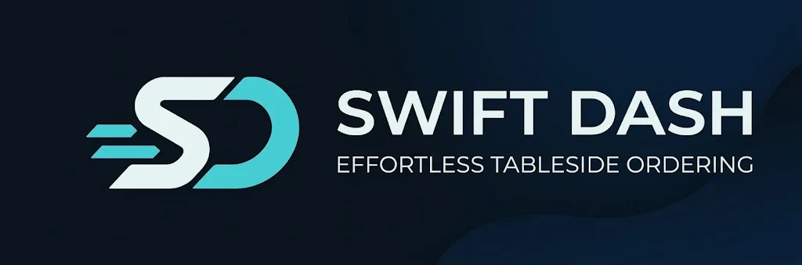

# Swift Dash — Effortless Tableside Ordering

Swift Dash — Effortless Tableside Ordering

## Features

* **Interactive Virtual Floor Plan (2400x2400 Canvas):**
  * *Free Drag & Drop Placement:* Position and scale 40+ tables per space with real-time collision detection.
  * *Custom Viewport Borders (Crop & Lock):* Define custom rectangular boundaries per floor area using interactive corner handles and toggle between **Locked** (strictly bounded zoom/pan) and **Free** roam camera modes.
  * *Multi-Space Support:* Create and manage multiple restaurant zones (e.g., Main Hall, Terrace, Roof Garden) with independent table layouts and border constraints.

* **Drag-to-Merge & Order Transfer:**
  * *Instant Order Transfer:* Long-press and drag any table onto another to move all active items and notes in one tap.
  * *Table Merging (Shared Bill):* Combine multiple tables into a unified group account with visual link badges and support for single-table detachment or full group unmerging.

* **Smart Fuzzy & Phonetic Search:**
  * *Typo-Tolerant Matching:* Powered by Levenshtein distance to find products even with spelling mistakes.
  * *Bilingual & Phonetic Normalization:* Seamlessly matches products across English, Greek, and Greeklish inputs, ignoring accents and duplicate characters.

* **Cash Register & Shift Analytics (Z-Report):**
  * *Full & Partial Payments:* Settle entire tables at once or select specific item quantities for split bills.
  * *Live Shift Dashboard:* Track total revenue, transaction count, closed tables, total items served, average spend per table, and detailed timestamped transaction logs.

* **Peer-to-Peer Wi-Fi Sync:**
  * *Built-in HTTP Server:* Broadcast your entire store setup (Spaces, Custom Map Borders, Tables, and Menu Catalog) over the local network.
  * *QR Code Pairing:* Sync secondary devices instantly by scanning the host's generated QR code—no cloud server or internet connection required.

## Getting Started

### For Users (Running the Release)

1. Download the latest `.apk` package from the **Releases** page on GitHub.
2. Transfer the `.apk` file to your Android device and open it to install.
3. Launch **Swift Dash** from your home screen.

**User Guide**

1. **Configure Your Store Setup:**
   * Navigate to the **Map Setup** and **Menu Setup** tabs using the bottom navigation bar.
   * Use the green **+** button to create floor spaces, add color-coded tables, and populate menu categories and products.
2. **Arrange Tables & Set Map Borders:**
   * On the **Floor Plan** tab, tap the **Lock** icon in the top bar to unlock table movement and drag tables into position.
   * Tap the **Crop** icon to adjust the blue bounding box around your tables (or tap **Auto Fit to Tables**) and press **Save & Lock** to constrain the camera to that area.
3. **Take Orders & Merge Tables:**
   * Tap any table to open the ordering screen, search for items, or long-press an item to set custom quantities, unit prices, and preparation notes.
   * Long-press and drag one table onto another on the map to **Transfer** its order or **Merge** the tables together.
4. **Settle Bills & Sync Devices:**
   * Choose **Partial** or **Full Payment** inside a table's order screen to log the transaction into the **Shift** tab.
   * Tap the orange **Sync** button in the top bar to host a Wi-Fi sync session or scan a QR code from another device.

### For Developers (Running via Flutter)

**Prerequisites**

* **Flutter SDK:** Version 3.x or higher.
* **Dart SDK:** Included with Flutter.
* **Android Studio / VS Code:** With Flutter and Dart plugins installed.

**Clone the repository**

```bash
git clone https://github.com/ThanasisKr219/Smart-Waiter.git
cd Smart-Waiter
flutter pub get
flutter run
```
